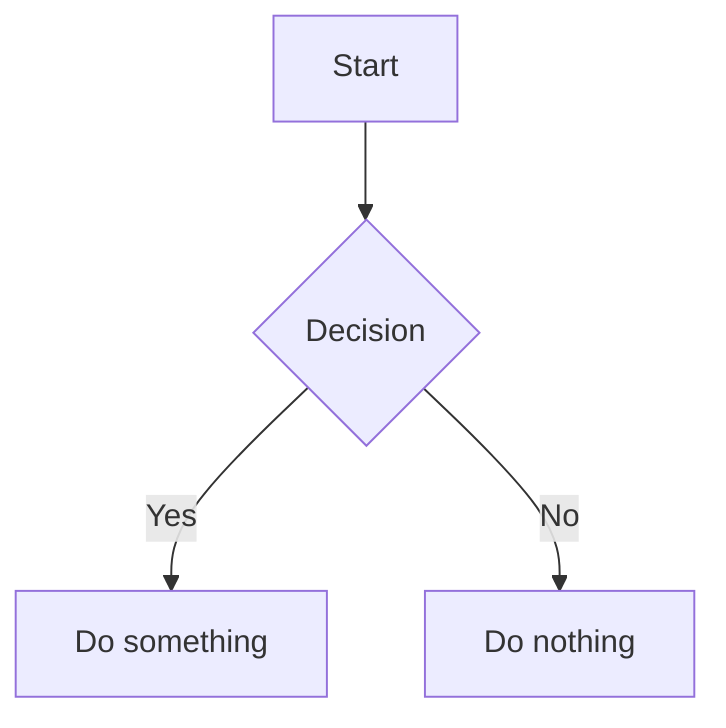
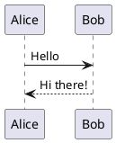

# Markdown Viewer Extension

A browser extension (Chrome / Edge) that renders local Markdown files with full support for:

- **Mermaid** diagrams (flowcharts, sequence diagrams, class diagrams, etc.)
- **PlantUML** diagrams (via configurable server)
- **Syntax highlighting** for common programming languages (via highlight.js)
- **Table of Contents** auto-generated from headings (collapsible, hidden when no headings)
- **Local links** — click links to other `.md` files to navigate between documents
- **Multiple windows** — open the extension multiple times for side-by-side comparison
- **Light / Dark / Auto** theme (defaults to VSCode-like GitHub rendering style)
- **Internationalization** — Chinese (zh), Japanese (ja), English (en)

## Installation

### From Release (Recommended)

1. Download the latest `.zip` from the [Releases](../../releases) page for your browser.
2. Unzip the file.
3. In Chrome: navigate to `chrome://extensions`, enable **Developer mode**, and click **Load unpacked**.
4. Select the unzipped folder.
5. In the extension settings, enable **Allow access to file URLs**.

### From Source

```bash
# Clone the repository
git clone https://github.com/tlcsdm/markdown-extension.git
cd markdown-extension

# Install dependencies
npm ci

# Build the extension
npm run build
```

Load `dist/chrome` (or `dist/edge`) as an unpacked extension.

## Usage

1. Click the **Markdown Viewer** icon in the browser toolbar.
2. A new tab opens with the viewer page.
3. **Open a Markdown file** using one of these methods:
   - Click the **Open File** button and select a `.md` file.
   - **Drag and drop** a `.md` file onto the viewer page.
4. The rendered Markdown is displayed with:
   - Table of Contents in the left panel (hidden when no headings exist).
   - Rendered content in the right panel.
5. Click **local links** (links ending in `.md`) to open linked files within the viewer.
6. Use the **Back** button to return to the previous document.

## Features

### Mermaid Diagrams

Wrap your Mermaid code in a fenced code block with the `mermaid` language identifier:

````markdown

````

### PlantUML Diagrams

Wrap your PlantUML code in a fenced code block with the `plantuml` language identifier:

````markdown

````

PlantUML diagrams are rendered via [Kroki](https://kroki.io) by default (requires internet access).

### Syntax Highlighting

All common programming languages are supported via [highlight.js](https://highlightjs.org/).

### Themes

Click the theme buttons in the toolbar:
- ☀️ **Light** — VSCode-like light theme
- 🌙 **Dark** — VSCode-like dark theme
- 💻 **Auto** — Follows the system preference (default)

## Development

```bash
# Install dependencies (downloads libraries to node_modules)
npm install

# Update bundled libraries from node_modules
npm run setup

# Build for Chrome
npm run build:chrome

# Build for Edge
npm run build:edge

# Build for all browsers
npm run build
```

### Project Structure

```
src/
  common/          # Shared source files
    _locales/      # i18n translations (en, zh, ja)
    icons/         # Extension icons
    lib/           # Bundled third-party libraries
    markdown-viewer.html   # Main viewer page
    markdown-viewer.js     # Rendering logic
    i18n.js        # Internationalization module
    styles.css     # VSCode-like styles
  chrome/          # Chrome-specific files
    manifest.json
    background.js
  edge/            # Edge-specific files
    manifest.json
    background.js
scripts/
  build.js         # Build script (copies src → dist)
  download-libs.js # Updates bundled libraries from node_modules
```

## Permissions

The extension requires:

- **`activeTab`** — to open the viewer in a new tab.
- **`https://kroki.io/*`** — for PlantUML rendering (can be changed in settings).
- **Allow access to file URLs** — must be manually enabled in `chrome://extensions` to render local files directly.

## License

MIT © [tlcsdm](https://github.com/tlcsdm)
